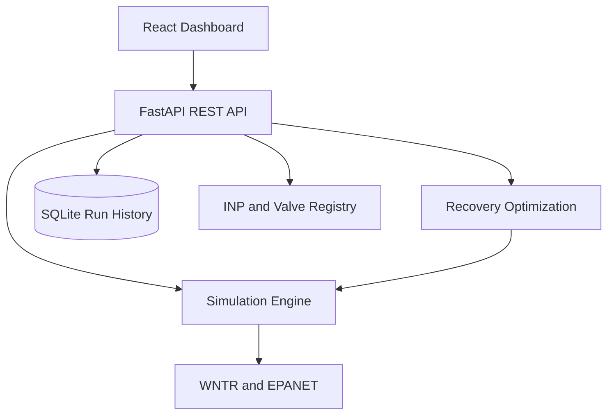

# Kiến trúc hệ thống AquaTwin-X

## Thành phần

| Thành phần | Vai trò |
| --- | --- |
| React + Vite | Xây dựng kịch bản, trực quan topology, theo dõi GA và xem evidence |
| FastAPI | Xác thực request, điều phối mô phỏng, job nền, history và report |
| WNTR + EPANET | Mô phỏng thủy lực theo Pressure-Driven Demand |
| Optimization | Exhaustive search cho baseline và Genetic Algorithm cho không gian lớn |
| SQLite | Lưu lịch sử run, KPI, cấu hình và kết quả đầy đủ |
| GitHub Actions | Test, xác thực Real WNTR và tạo benchmark artifact |

## Luồng quyết định

1. Người vận hành chọn mạng và đường ống gặp sự cố.
2. Backend chạy trạng thái sự cố và tính các KPI ảnh hưởng.
3. Người vận hành thử đóng van thủ công hoặc yêu cầu GA tìm phương án.
4. Mỗi ứng viên được mô phỏng lại và chấm điểm theo service, pressure, leakage và số thao tác.
5. Dashboard hiển thị phương án, convergence, so sánh trước/sau và lưu evidence.

## Ranh giới khoa học

- `real`: bắt buộc WNTR, dùng cho thực nghiệm và kết luận.
- `demo`: dữ liệu tổng hợp có nhãn cảnh báo, chỉ dùng trình diễn giao diện.
- `auto`: ưu tiên WNTR và chỉ fallback sang demo khi môi trường local không tải được native dependency.
